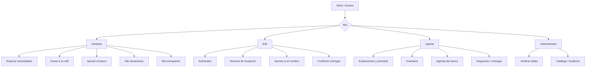

> **AVISO — Documento histórico superado:** Esta especificación v2.0 corresponde al prototipo anterior y **no debe usarse para generar código**. Las referencias normativas activas son [`propuesta_mockup.md`](propuesta_mockup.md) (v4.0), [`Mockup_Alimenta_Taste_v6_Menu_Superior.html`](Mockup_Alimenta_Taste_v6_Menu_Superior.html), [`lineamientos_diseno.md`](lineamientos_diseno.md) y [`AGENTS.md`](AGENTS.md).

# Alimenta — Propuesta de mockup funcional integrado

**Versión 2.0 · 20 de noviembre de 2026**  
**Documentos de referencia:** `propuesta.md` revisada, diagrama general de donaciones y bosquejo de navegación en pizarra.  
**Estado:** diseño funcional y prototipo HTML navegable con datos ficticios, sin infraestructura real.

## 1. Qué cambió desde el mockup 1.0

La plataforma conserva las funciones originales de ediles, agentes, donantes, comunidades e inventario, así como la calificación humana de la necesidad. Introduce **dos subsistemas nuevos**: **agenda y coordinación de transporte** y **ofertas directas a un edil sin solicitud**. La segunda innovación no requiere crear una necesidad artificial: se registra como un ofrecimiento a una comunidad, gestionado por un representante verificado.

| Antes | Ahora (v2.0) | Beneficio |
|---|---|---|
| «Coordinación» sin actor de transporte | Donante o voluntario transportador explícito | Responsabilidad asignada y aceptada |
| Edil confirmaba recepción sin publicar horarios | Edil administra ventanas horarias y cupos | Donante elige fecha/hora habilitada |
| Banco contaba con ingreso físico sin cita | Agente publica/valida citas de ingreso | Evita arribos no previstos |
| Asignación del banco → despacho poco definido | Agente propone hora de comunidad + voluntario; éste acepta; banco autoriza retiro | Desacopla gestión y transporte |
| Donación directa solo ligada a petición publicada | Tercera ruta: elegir edil verificado, producto, cantidad y cita | Permite aportes espontáneos trazables |
| Estado único de entrega | Cita solicitada, aceptada, salida, en transporte y confirmación | No confunde promesas con ayuda entregada |

## 2. Viabilidad y compatibilidad

**Compatibilidad con el documento funcional: alta**, sin eliminar su catálogo jerárquico, roles, mecanismo de evaluación `G ∈ {1,2,3,4,5}` ni diferenciación de recibido/comprometido/reservado. Es una **ampliación de alcance**: debe comprobarse con usuarios reales que los ediles puedan administrar horarios, que haya transportadores disponibles y que el banco tenga un responsable de recepción física.

**Viabilidad técnica:** alta para un MVP web transaccional con sesiones y permisos por rol, agendas, reservas de cupos, inventario y auditoría. **Viabilidad operativa:** condicionada a sede, disponibilidad de personas, seguridad, puntos de entrega, responsabilidad del transporte, política de alimentos y custodia. La existencia de un mockup no valida su funcionamiento en campo.

### Responsables por trayecto

| Trayecto | Agenda / decisión | Transportador | Confirmador |
|---|---|---|---|
| Donante → edil, necesidad registrada | Edil publica; donante elige; edil acepta | Donante aportante | Edil |
| Donante → edil, donación espontánea | Edil publica; donante elige; edil acepta/rechaza | Donante aportante | Edil |
| Donante → banco | Agente publica y confirma/ajusta la cita | Donante aportante | Responsable del banco |
| Banco → comunidad | Agente reserva, propone hora y transportador; edil ofrece horarios | Donante voluntario que acepta | Edil |

**Supuesto operacional:** los donantes que entregan al banco no tienen que volver a transportar esos mismos artículos. Otro donante puede aceptar el trayecto desde el banco a la comunidad. Si nadie acepta, no se despacha.

## 3. Arquitectura de la experiencia

El selector de rol del HTML existe **solo para revisar el diseño**. En un producto real los roles no pueden elegirse libremente para ejecutar acciones protegidas. El selector de edil de la demo permite comprobar aportes a dos comunidades ficticias.

## 4. Mapa de pantallas especificadas

| ID | Pantalla | Actor | Componentes esenciales |
|---|---|---|---|
| P01 | Portada pública | Todos | Qué es Alimenta, modalidades y acceso. |
| P02 | Acceso/registro | Todos | Inicio de sesión, solicitud de rol y verificación. Google queda opcional. |
| P03 | Inicio donante | Donante | **Tres caminos:** necesidad, banco, edil específico. |
| P04 | Necesidades publicadas | Donante | Comunidad, categoría, producto, cantidades y estado. |
| P05 | Detalle de necesidad | Donante | Solicitud, saldo pendiente/aportable, edil, calendario. |
| P06 | Comprometer aporte a necesidad | Donante | Producto, cantidad, selección de hora habilitada, notas, compromiso. |
| P07 | Aportar al banco | Donante | Producto, cantidad, hora preferida del banco, condiciones de traslado. |
| P08 | Mis donaciones | Donante | Citas, aceptación, estado de transporte, cancelación y comprobantes. |
| **P09** | **Donación a un edil sin solicitud** | **Donante** | **Directorio verificado de ediles, artículo, cantidad, propósito, horario del edil y envío de ofrecimiento.** |
| **P10** | **Mis transportes** | **Donante** | **Activar disponibilidad, recibir propuesta del agente, aceptar y marcar inicio del recorrido.** |
| P11 | Inicio edil | Edil | Solicitudes, entregas pendientes y ofertas espontáneas. |
| P12 | Mis solicitudes | Edil | Detalle e historial de peticiones de su comunidad. |
| P13 | Nueva solicitud | Edil | Categoría, producto, cantidades, personas, hogares y motivos; nunca selector de `G`. |
| **P14** | **Horarios de recepción comunitaria** | **Edil** | **Crear ventanas con fecha, inicio/fin y cupos por hora; cerrar sin compromisos activos.** |
| **P15** | **Aportes dirigidos a mí** | **Edil** | **Aceptar o rechazar espontáneas y citas de necesidades; registrar responsabilidad.** |
| P16 | Confirmar recepción | Edil | Producto, cantidad real, prueba, total/parcial, incidencia. |
| P17 | Inicio agente | Agente | Evaluaciones, alertas G5 y citas del banco pendientes. |
| P18 | Bandeja/evaluación | Agente | Grado 1–5, justificación, tiempo/afectados, puntuación ilustrativa. |
| P19 | Inventario y recepción | Agente | Stock físico, compromisos, lotes y verificación de ingreso. |
| **P20** | **Agenda del banco** | **Agente** | **Ventanas bancarias y confirmación/ajuste de la cita de ingreso.** |
| **P21** | **Asignación y programación desde banco** | **Agente** | **Reserva, ventana comunitaria, donante transportador, aceptación, retiro autorizado y seguimiento.** |
| P22 | Verificación de ediles / catálogo | Administrador | Aprobar representantes y administrar productos. |
| P23 | Auditoría | Administrador | Actor, fecha, objeto, acción y motivo. |

### Interacción de un selector de horario

**Componente:** `Fecha y hora de entrega`.

- Solo enumera horas de ventanas activas del receptor correspondiente, con **capacidad disponible**.
- Un ofrecimiento reserva un cupo, pero **no autoriza salir**: el receptor todavía puede rechazar la cita.
- Si la ventana es retirada o se completa su capacidad, el sistema no debe permitir crear el compromiso.
- Las reprogramaciones conservan historial y deben ser aceptadas por quienes se desplazan.
- Se conserva zona horaria local (`America/Bogota`, como hipótesis inicial de despliegue).
- El mockup usa bloques de una hora, sin calendarios externos ni envío real de notificaciones.

## 5. Recorridos operativos que deben probarse

### F01. Directa a necesidad

`Donante consulta solicitud → elige cantidad y hora del edil → cita pendiente → edil acepta → donante marca salida → edil verifica entrega → la necesidad descuenta únicamente lo recibido`.

**Invariantes:** no superar saldo aportable, no admitir horarios fuera de cupo, ninguna promesa reduce pendiente real, un rechazo libera cantidad y cupo.

### F02. Espontánea a edil

`Donante abre «Donar a un edil» → selecciona edil verificado → artículo + cantidad + propósito → elige horario del edil → envía ofrecimiento → edil acepta/rechaza → donante transporta → edil confirma recepción → registro independiente de aportes comunitarios`.

**Invariantes:** `detalle_solicitud_id = NULL`, no crear petición falsa, no alterar puntaje `G`, no sumar stock bancario, no exponer domicilio privado. Una futura asignación de esos productos a una necesidad necesita conciliación aprobada y auditada.

### F03. Ingreso al banco

`Donante ofrece productos → elige cita bancaria → agente confirma o propone nueva hora → donante acepta la alternativa si la hubo → transporta al banco → marca llegada → banco verifica cantidad y aptitud → aumenta existencias aceptadas`.

**Invariantes:** sin recepción física no existe stock disponible; no debe aceptarse una hora alternativa sin consentimiento del donante.

### F04. Salida del banco hacia la comunidad

`Agente evalúa → reserva inventario → selecciona franja de edil → propone voluntario donante → voluntario acepta → banco autoriza retiro → donante transporta → edil confirma → se descuenta saldo e inventario despachado`.

**Invariantes:** sin voluntario no hay salida; sin stock no hay reserva; sin cita activa no se propone ruta; sin recepción no se considera entregada.

### F05. Incidencias y parciales

Cuando se prometen 10 unidades y se reciben 7, la confirmación es por 7. Las 3 restantes quedan como discrepancia pendiente de conciliación/reprogramación. No se liberan automáticamente como inventario ni se descuentan del saldo de necesidad.

## 6. Reglas de negocio revisadas

| Regla | Resultado UI / backend esperado |
|---|---|
| R01 | `G` solo puede guardarlo un agente con justificación. |
| R02 | El edil habilita horas **para su comunidad**, no para otros ediles. |
| R03 | El agente habilita recepción del banco y puede proponer otro horario; el donante debe aceptar el cambio. |
| R04 | Cupo de cita atómico: no sobreagendar ventanas. |
| R05 | Los donantes transportan. Un segundo donante debe aceptar el trayecto banco → comunidad. |
| R06 | Banco: prometido ≠ recibido ≠ reservado ≠ despachado ≠ entregado. |
| R07 | La donación espontánea a edil no crea necesidad ni reduce saldo por defecto. |
| R08 | Las donaciones espontáneas solo admiten ediles **verificados** y se destinan a su comunidad. |
| R09 | Rechazar/cancelar/vencer libera cupo y compromiso lógico, pero no borra auditoría. |
| R10 | Parciales generan saldo e incidencia separados. |
| R11 | No publicar domicilios, beneficiarios o contacto privado en listados públicos. |
| R12 | Medicamentos y aportes monetarios quedan fuera del alcance demostrado. |

## 7. Modelo de datos que respalda el mockup

El `propuesta.md` revisado contiene el esquema lógico completo. Se requieren especialmente:

- `ediles_comunidades` para identificar destinatarios autorizados.
- `ventanas_disponibilidad` para fecha, bloque, cupo, receptor, estado.
- `citas_entrega` para propuesta, aceptación, vencimiento y reprogramación.
- `transportes` con `donante_transportador_id`, origen, destino, aceptación, hora y estado.
- `donaciones` con modalidad y `edil_destinatario_id` opcional; `detalle_solicitud_id` **nulo** cuando el aporte no responde a una necesidad.
- `recepciones_aportes_dirigidos` para registrar bienes espontáneos y custodio comunitario.
- `entregas`, `detalle_entrega` y `auditoria` para conciliación de cantidades y evidencias.

En implementación real, las citas y los saldos se validan **en transacciones del servidor**, no con cálculos de un navegador aislado. El sistema debe evitar registros duplicados por doble clic, confirmaciones repetidas y cambios de hora concurrentes.

## 8. Pruebas de aceptación del diseño

1. El edil publica una ventana de 09:00 a 12:00 con capacidad 1; el donante ve 09, 10 y 11 como opciones separadas.
2. Dos ofrecimientos no reservan el mismo bloque con capacidad 1; si se rechaza uno, el cupo vuelve a estar libre.
3. Donante elige un edil verificado y hace un aporte de 3 productos sin solicitud; el edil lo acepta y registra recepción completa sin cambiar el saldo de ninguna necesidad.
4. Un edil diferente no ve ni aprueba el ofrecimiento ajeno.
5. Una donación a una necesidad queda comprometida pero no se contabiliza como recibida antes de la confirmación del edil.
6. Donante solicita cita al banco: el agente la confirma; solo después de llegada y verificación las unidades ingresan al inventario.
7. Agente reserva unidades del banco y propone transporte a un voluntario; sin su aceptación no puede despachar.
8. Tras aceptación, el agente autoriza retiro y el donante marca inicio; el edil confirma y el saldo se actualiza una sola vez.
9. Una recepción parcial mantiene el resto bajo incidencia hasta conciliación.
10. El edil no puede cambiar G; un agente no puede calificar sin motivo y G5 conserva aviso crítico.
11. Cancelar un compromiso no reduce las unidades efectivamente entregadas.
12. Un usuario no autorizado nunca puede acceder a datos privados de localización ni de beneficiarios.

### Estado de la demostración HTML

Se validaron los recorridos visuales de: **(a)** ofrecimiento sin solicitud a edil Manrique → aceptación → transporte → confirmación; **(b)** aporte directo a necesidad → aceptación → transporte → confirmación; **(c)** ingreso a banco → cita confirmada → llegada → verificación; y **(d)** reserva del banco → transporte voluntario → retiro → recepción del edil. En una sesión de pruebas de navegador no se detectaron errores JavaScript. Esto **no prueba** la seguridad, concurrencia, rendimiento, accesibilidad completa ni consistencia de un backend inexistente.

## 9. Alcance, límites y decisiones pendientes

El demo permite cambiar de rol, gestionar ventanas, registrar citas/ofertas, aceptar o rechazar y confirmar entregas con datos locales ficticios. No incluye servidor, autenticación, notificaciones, Google real, persistencia, direcciones reales, validación legal, trazabilidad GPS ni reserva concurrente entre usuarios.

Pendiente de validar: disponibilidad efectiva de ediles; criterios de habilitación de donantes transportadores; sedes y puntos de encuentro; reglas de tiempos límite y reprogramación; custodia y conflictos de interés de aportes a ediles; gestión de perecederos y responsabilidades por daño o pérdida.

## 10. Archivos de la entrega

- `propuesta.md`: propuesta funcional revisada y reglas completas.
- `Propuesta_mockup_Alimenta.md`: este documento de UX, pantallas, escenarios y criterios.
- `Mockup_interactivo_Alimenta.html`: demo navegable autónoma.
- `Flujo_integrado_Alimenta.svg` y `.dot`: diagrama general (vectorial y editable).
- `Vista_general_mockup.png`: resumen gráfico de pantallas.
- `pantalla_*.png`: capturas de las rutas principales del prototipo.
- `LEEME.md`: instrucciones de uso de la demo.

**Principio rector:** *el donante lleva la ayuda; el edil publica horarios, acepta y confirma; el agente prioriza y coordina el banco; el sistema garantiza trazabilidad en un producto real*.
