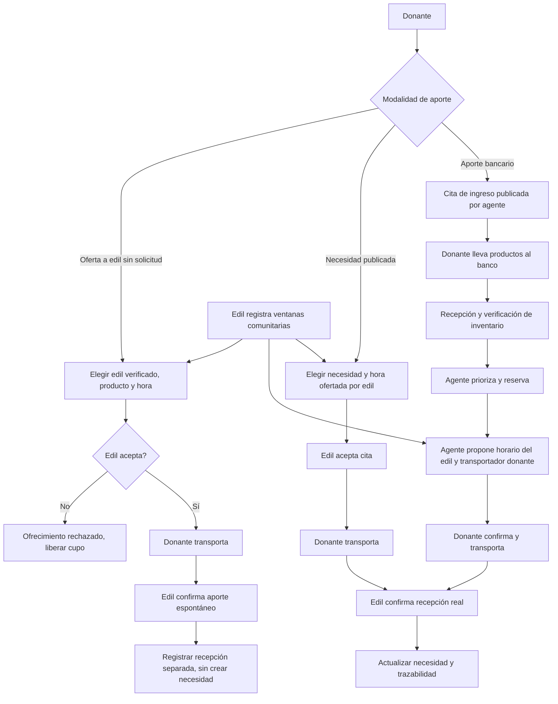

# Propuesta de plataforma virtual para gestión de donaciones comunitarias

**Documento de propuesta funcional — versión 2.1 (20 de noviembre de 2026)**

**Estado:** diseño conceptual y funcional actualizado con base en las patentes y antecedentes aplicables ([`aplicabilidad-patentes-alimenta.md`](../Documentos-prototipos/aplicabilidad-patentes-alimenta.md)); los horarios, transportes y autorizaciones no están operando en un servicio real.

## 1. Resumen ejecutivo

Se propone desarrollar una plataforma virtual que conecte **donantes** con **comunidades** mediante tres recorridos de aporte: **(1) donación al banco**, **(2) donación directa para atender una necesidad publicada** y **(3) donación espontánea dirigida a un edil específico**, aunque no exista una solicitud registrada del producto.

Las necesidades son reportadas por los **ediles**; los **agentes** califican su grado (1–5), priorizan y asignan inventario del banco. Los donantes que aportan o se ofrecen voluntariamente para trasladar artículos **asumen el transporte**. El edil publica ventanas de recepción para la comunidad y acepta o rechaza aportes; el agente publica la agenda del banco, acuerda las citas de ingreso y coordina las salidas del banco con ediles y donantes transportadores.

**Distinción esencial:** compromiso ≠ cita confirmada ≠ despacho ≠ recepción verificada. El banco no tiene stock por promesas, y el saldo de una necesidad solo cambia al confirmar la recepción correspondiente. Un aporte dirigido a un edil sin solicitud es un registro independiente y **no reduce automáticamente necesidades ni modifica su prioridad**.

La plataforma recomienda, organiza y registra; **el agente decide asignaciones**, **el edil verifica la recepción**, **el donante realiza el transporte**. Se mantiene trazabilidad de actor, fecha, productos, cita, cantidades e incidencias. Para donaciones dirigidas a un edil, el destinatario final debe ser la comunidad, nunca el patrimonio personal del representante.

**Fundamentación en patentes y antecedentes aplicables (v2.1):** sobre esta estructura base se incorporan cuatro pilares asistidos que respetan las exclusiones del MVP y la decisión humana (*Human-in-the-Loop*): (1) el **Catálogo de Ayudas Técnicas UNAL** (MUUPA, muleta axilar plegable y Sistema *Anatom*) dentro de `Salud y asistencia`; (2) **asistencia de priorización con equidad y reparto parcial sugerido bajo escasez** (inspirada en arquitectura multi-agente *Cureus Journals*, `US11393577B2` y `US8494885B2`, cruzada con datos territoriales agregados de Manizales `ab8a-uwf7`); (3) **emparejamiento asistido donante–necesidad** (*ReliefMatcher.AI* + `US11037098B2`, cerrando la brecha de verificación en terreno mediante ediles/JAC); y (4) una capa de **accesibilidad universal** (`WO2026151479A1`, `US20200133474A1`, referencia LSC `US20170236450A1` / Sistema ECOS) junto con una **ruta separada de derivación a Primeros Auxilios Psicológicos (PAP) UNAL** (`WO2021247792A1`, `CN102708284A`) sin almacenar datos clínicos ni identidades.

## 2. Estructura gráfica explicativa

El modelo conserva donantes, ediles, agentes, banco y comunidades, y añade el sistema de agendas y una tercera forma de aporte. Se incluyen `Flujo_integrado_Alimenta.svg` y la fuente editable `.dot` dentro del paquete de mockup.

**Punto crítico de diseño:** el agente no traslada el inventario; debe existir un transportador donante identificado y que haya aceptado la programación antes del despacho desde el banco.

## 3. Objetivo general

Construir una interfaz virtual que permita **recibir, clasificar, evaluar, priorizar, asignar, programar transporte y verificar** donaciones destinadas a comunidades, incluso aportes espontáneos dirigidos a un edil, con responsabilidades diferenciadas, datos organizados y seguimiento transparente.

### Objetivos específicos

1. Estandarizar la manera en que los ediles reportan necesidades.
2. Facilitar a los agentes una evaluación consistente y verificable.
3. Conectar solicitudes con el inventario real del banco y con donantes directos.
4. Permitir entregas completas o parciales sin perder el saldo pendiente.
5. Mantener historial de solicitudes, donaciones, asignaciones, agendas, transporte y recepción.
6. Ofrecer donaciones a un edil verificado sin necesidad previa, con aceptación y custodia.
7. Permitir al donante seleccionar hora de transporte de las ventanas del edil y al agente coordinar las del banco.

## 4. Actores y permisos

| Actor | Funciones permitidas | Restricciones principales |
|---|---|---|
| **Edil** | Reportar necesidades, representar las comunidades autorizadas, publicar ventanas de disponibilidad de recepción, confirmar/denegar citas, aceptar/rechazar ofrecimientos dirigidos, confirmar entregas, registrar incidencias. | No asigna `G`, no distribuye inventario bancario y no puede apropiarse personalmente de los aportes. Solo gestiona sus comunidades y horarios. |
| **Agente** | Revisar y calificar necesidades (`G` 1–5), justificar evaluación, priorizar, verificar o delegar verificación bancaria, publicar/gestionar ventanas del banco, confirmar/ajustar citas bancarias, reservar inventario y proponer transportador y hora de salida. | No debe asumir automáticamente que él realiza el transporte; requiere consentimiento del donante transportador. Movimientos auditables. |
| **Donante aportante** | Elegir necesidad, producto o edil verificado; ofrecer cantidad; seleccionar horario de ventanas disponibles; transportar al banco o a la comunidad; consultar, confirmar o cancelar citas según reglas. | No modifica necesidades, calificaciones o inventarios. No debe trasladar una oferta pendiente de aceptación. |
| **Donante transportador** | Inscribirse voluntariamente para retirar del banco y entregar a la comunidad; aceptar o rechazar propuestas de traslado; marcar retiro/inicio del recorrido y reportar incidencias. | No toma decisiones de asignación ni acredita por sí mismo una recepción comunitaria. Puede coincidir o no con el aportante original. |
| **Administrador** | Verificar ediles y permisos, administrar catálogo y autorizaciones, auditar agendas, movimientos y entregas; resolver incidencias bajo políticas. | No altera historia ni permite actuar a representantes no verificados. |
| **Comunidad** | Recibir bienes y comunicar necesidades a través del edil. | No requiere cuenta individual; no publicar datos privados de hogares o beneficiarios. |

**Separación de funciones:** agente asigna inventario y coordina, el donante voluntario transporta, el edil recibe/verifica. En el banco el personal autorizado valida el ingreso físico antes de contabilizar existencias.

## 5. Tres recorridos de donación

### 5.1. Aporte al banco de donaciones

**Primera etapa: del donante al banco.**

1. El agente configura ventanas de recepción del banco (fecha, hora inicial y final, duración del bloque, cupos por bloque y sede autorizada).
2. El donante registra productos, presentaciones, cantidades y una **hora preferida** dentro de esas ventanas. También puede indicar condiciones de transporte.
3. El agente **confirma el horario o propone otro** de las ventanas disponibles. Si cambia la hora elegida, el donante debe aceptar la alternativa antes de desplazarse (el mockup incluye aceptación o rechazo de una propuesta de horario alternativo).
4. El donante transporta los productos al banco. La llegada se marca separadamente de la recepción.
5. El responsable bancario verifica recepción, aptitud, cantidad, especificación, ubicación y lote cuando corresponda. Solo lo aceptado entra al **inventario disponible**.

**Segunda etapa: del banco a una comunidad.**

6. El agente evalúa las solicitudes, selecciona una necesidad y **reserva** productos del banco sin superar existencias aptas.
7. Consulta ventanas de recepción publicadas por el edil y la disponibilidad de donantes transportadores. Propone hora, punto de recogida, cantidad y transportador.
8. Un donante transportador **acepta** la propuesta; el banco autoriza y registra la salida. No se despacha si nadie acepta transportar.
9. El transportador entrega en la cita; el edil confirma productos y cantidades efectivas. El sistema ajusta saldo pendiente y registra incidencias si hay diferencias.

El donante que transporta desde el banco **puede ser distinto** del aportante original. El agente coordina, no es transportista por defecto. Si no hay transportador o cupo de recepción confirmado, la reserva sigue pendiente, sin marcar despacho.

### 5.2. Donación directa a una necesidad publicada

1. El edil registra la necesidad y el agente la evalúa. La publicación se realiza según la autorización del sistema.
2. El edil publica **ventanas de recepción comunitaria** con fecha, rango horario y cupos.
3. Un **asistente de emparejamiento** (inspirado en *ReliefMatcher.AI* y `US11037098B2`) permite al donante indicar el producto y la cantidad que desea aportar, sugiriendo necesidades compatibles según categoría del catálogo, saldo aportable y **ventanas abiertas con cupo del edil**. A diferencia de esquemas puramente digitales sin control en campo, la verificación en terreno queda cubierta por los ediles/JAC autorizados.
4. El donante elige comunidad, producto y cantidad aportable, luego selecciona **una hora** dentro de las ventanas del edil.
5. El sistema registra el compromiso y solicita la aceptación del edil. La capacidad del horario se bloquea temporalmente conforme a la política de vencimiento.
6. Tras aceptación, el donante **transporta directamente** los productos al punto acordado mediante un canal privado. El edil confirma recepción o reporta rechazo/incidencia.
7. El saldo pendiente de la necesidad solo disminuye por **unidades efectivamente recibidas**, no por la cita ni por la promesa.

La donación no pasa por inventario bancario. Si el edil no tiene horarios abiertos, se muestra «Sin horarios disponibles» y no se crea una cita no autorizada. Las reservas pueden vencer o cancelarse con liberación de cupo y saldo aportable.

### 5.3. Donación dirigida a un edil específico, sin necesidad previamente registrada

El donante debe poder buscar y **seleccionar un edil verificado por nombre o comunidad**, elegir producto y cantidad, describir el aporte y seleccionar un horario publicado por ese representante, **aunque no exista una solicitud para esos artículos**. Como apoyo orientativo (inspirado en `US11037098B2`), si el producto elegido coincide con una necesidad ya publicada en esa u otra comunidad, el sistema puede mostrar un aviso no bloqueante para que el donante decida si prefiere atender dicha solicitud o mantener el ofrecimiento espontáneo.

1. Se crea un ofrecimiento de tipo **dirigido a edil**, con `detalle_solicitud_id = NULL`, `edil_destinatario_id`, comunidad, artículo, cantidad, donante, fecha/hora y observación.
2. El edil ve el ofrecimiento en su bandeja, determina si es pertinente, apto y gestionable y **acepta o rechaza**; un rechazo libera el cupo y se conserva su motivo.
3. Si lo acepta, se confirma la cita. El donante transporta el artículo y el edil confirma cantidad y condición efectivamente recibidas.
4. La donación aceptada se registra en un **historial de aportes espontáneos a la comunidad**, con responsable de custodia y destino final. No incrementa inventario bancario, no crea automáticamente una solicitud y **no altera prioridades ni saldos de peticiones existentes**.
5. Una vinculación posterior a una necesidad solo puede hacerse mediante un procedimiento autorizado y auditado que evite contabilizar dos veces el mismo artículo.

**Control ético:** es una donación **para la comunidad, administrada por el representante**, no un regalo personal al edil. Debe validarse con el equipo legal y de gobierno la admisibilidad de estos aportes, eventuales conflictos de interés y reglas de custodia. Se excluyen dinero/medicamentos del flujo simplificado del MVP.

### 5.4. Principio común de trazabilidad

Para los tres recorridos, registrar por separado: oferta, cita solicitada, cita aceptada, responsable del transporte, salida, llegada, recepción confirmada, cantidad aceptada, discrepancias, cancelación/reprogramación y huella de auditoría.

## 6. Registro estandarizado de necesidades

Se adopta un **catálogo de cuatro niveles**: `categoría → subcategoría → producto → especificación/presentación`.

| Categoría | Ejemplos de subcategorías |
|---|---|
| Alimentación | No perecederos; perecederos; agua potable; alimentación especial. |
| Higiene y cuidado personal | Higiene corporal; higiene bucal; higiene menstrual; cuidado personal. |
| Bebés y primera infancia | Pañales; alimentación infantil; ropa y cuidado infantil. |
| Salud y asistencia | Primeros auxilios; elementos de protección; dispositivos de apoyo (**Catálogo de Ayudas Técnicas UNAL**: MUUPA, muleta axilar plegable, Sistema *Anatom*). |
| Hogar y limpieza | Productos de limpieza; utensilios; cocina; ropa de cama. |
| Vestuario | Ropa adulta; ropa infantil; calzado; prendas de abrigo. |
| Materiales y vivienda | Materiales de construcción; herramientas; reparaciones. |
| Bienestar animal | Alimentos; higiene animal; accesorios. |
| Educación | Útiles escolares; mochilas; libros; materiales educativos. |

**Formulario de petición del edil:** comunidad/barrio; uno o varios productos del catálogo; especificación; cantidad y unidad; personas y hogares afectados; justificación; observaciones opcionales. La plataforma agrega fecha, hora, identificador y estado automáticamente. **El formulario del edil NO incluye el grado de necesidad.**

Se permitirán solicitudes por **productos individuales** y por **kits** previamente definidos. Cada kit tendrá una lista de componentes y cantidades, para evitar inventarios inconsistentes. La opción «No encuentro el producto» enviará una propuesta de producto a revisión administrativa antes de incorporarlo al catálogo.

### Catálogo de Ayudas Técnicas UNAL

Dentro de `Salud y asistencia → dispositivos de apoyo` y `kits`, se habilita el catálogo de tecnologías físicas desarrolladas por la **Universidad Nacional de Colombia (UNAL)** para atender poblaciones vulnerables sin alterar el esquema base de inventario:

- **MUUPA — Mango universal para operar puertas con pies o antebrazos (Radicado SIC: `NC2021/0010846`, Sede Bogotá):** lotes solicitables por ediles para adecuar puertas sin perforación en albergues, comedores comunitarios y puntos de acopio.
- **Muleta axilar plegable con medio elástico en los perfiles de soporte (Patente de invención SIC):** ayuda técnica de movilidad reducida para adultos mayores y personas con discapacidad física.
- **Sistema *Anatom* de posicionamiento antiescaras (Sede Palmira, en trámite de patente):** kit modular de cojines ergonómicos para personas con movilidad reducida y apoyo directo a cuidadores.

> **Resguardo de propiedad industrial:** Alimenta no fabrica, reproduce ni comercializa estas invenciones; actúa únicamente como canal de visibilización y coordinación de donaciones o padrinazgo institucional respetando la titularidad de la UNAL ante la SIC.

### Prevención de duplicados

Al crear una solicitud, el sistema buscará peticiones activas de la misma comunidad y producto (o kit). En vez de bloquear automáticamente, avisará de la coincidencia y permitirá **actualizar la petición existente** o justificar una solicitud independiente.

## 7. Evaluación y priorización de solicitudes

La priorización usa **tres criterios**, acordados para el proyecto:

1. **Tiempo de la petición (`T`)**: días transcurridos desde el registro, calculados automáticamente.
2. **Personas afectadas (`A`)**: dato reportado por el edil y sujeto a verificación.
3. **Grado de necesidad (`G`)**: **calificación de 1 a 5 asignada exclusivamente por el agente**, con justificación obligatoria.

### Fórmula inicial propuesta

Se utilizará un puntaje ponderado, con las tres variables normalizadas a una escala de 1 a 5:

\[
P = 0.50G + 0.30A + 0.20T
\]

| Variable | Peso inicial | Origen |
|---|---:|---|
| `G` grado de necesidad | 50 % | Agente |
| `A` afectación por personas | 30 % | Edil; normalización por el sistema |
| `T` antigüedad | 20 % | Sistema |

Los pesos y rangos de normalización son **provisionales**. Antes de ponerlos en producción deben revisarse con escenarios reales y representantes de las comunidades. En particular, no debe asumirse que el barrio más grande es automáticamente el más prioritario: se puede contemplar la proporción de personas afectadas respecto a su población total para contrastar los resultados.

### Asistencia con equidad y sugerencia de reparto bajo escasez

Inspirado en el marco multi-agente con equidad (*Cureus Journals*, 2026) y los modelos de optimización bajo escasez (`US11393577B2` y `US8494885B2`), el panel del agente complementa `P` con **tres lentes orientativos**:

1. **Urgencia (*Triage*):** basada en la calificación humana `G` (con alerta inmediata para `G = 5`).
2. **Equidad territorial (*Equity*):** contrasta el volumen de personas afectadas (`A`) y la antigüedad (`T`) frente a indicadores territoriales agregados por zona/comunidad (replicables en Manizales mediante [`Bases de datos/download_manizales_data.py`](../Bases%20de%20datos/download_manizales_data.py), dataset `ab8a-uwf7`, `cod_mpio = 17001`), evitando que comunidades pequeñas o vulnerables queden rezagadas frente a sectores más populosos. Nunca expone registros individuales de hogares.
3. **Viabilidad logística (*Logistics*):** cruza el stock físicamente disponible en `inventario_lotes` con ventanas activas del edil y disponibilidad de donantes transportadores.

Cuando las unidades libres en el banco sean menores que la demanda de múltiples solicitudes evaluadas, el sistema puede calcular una **sugerencia orientativa de reparto parcial** (respetando prioridades críticas `G = 4–5`, equidad territorial y el saldo pendiente sin reiniciar `T`). Esta sugerencia nunca auto-reserva stock ni modifica `G`: el agente decide si la adopta, ajusta o descarta.

### Escala propuesta para `G`

| Grado | Definición para el agente |
|---|---|
| 1 — Muy bajo | Existen alternativas razonables; no hay urgencia. |
| 2 — Bajo | Carencia que puede esperar sin consecuencias inmediatas. |
| 3 — Medio | La carencia afecta el bienestar cotidiano de manera sostenida. |
| 4 — Alto | Falta importante de recursos esenciales que exige pronta atención. |
| 5 — Crítico | La falta de ayuda compromete de manera inmediata la salud, seguridad o subsistencia. |

**Reglas de seguridad operativa:** una petición sin evaluación estará en **pendiente de evaluación** y no tendrá puntaje definitivo. Una solicitud con `G = 5` activará una **alerta de revisión inmediata** y no dependerá solo del puntaje. El agente mantiene la decisión sobre las asignaciones y sus motivos quedan auditados.

La prioridad debe estar asociada a **cada necesidad específica**, no al barrio entero. Un mismo barrio puede tener solicitudes con grados distintos.

## 8. Inventario, agenda, transporte y entregas

### 8.1. Inventario del banco

Distinguir: **comprometida** (prometida, no recibida), **recibida/verificada** (admitida físicamente), **disponible** (apta y libre), **reservada** (asignada a solicitud), **despachada** (salió con transportador identificado) y **entregada** (confirmada por edil).

Ninguna unidad comprometida entra a disponible hasta verificación física. Las reservas no pueden exceder disponibilidad. Los movimientos incluyen autor, fecha, cantidad, producto/presentación, lote cuando corresponda, origen, destino y observaciones. Perecederos requieren controles de vencimiento y conservación.

### 8.2. Publicación de ventanas y reserva de citas

**Ventana horaria:** actor propietario (edil o agente), receptor habilitado (comunidad/banco), fecha, hora de inicio y fin, zona horaria, duración de bloque, capacidad por bloque, vigencia y estado (activa/cerrada). El mockup usa bloques **de una hora**, pero la duración debe ser configurable en el producto real.

**Cita/turno:** ventana y bloque seleccionado, donación o entrega vinculada, donante que transporta, receptor, estado, fecha de creación, aceptación/ajustes y motivo de cambios. Si un edil administra varias comunidades, debe seleccionar aquella para la que abre cada ventana.

Reglas mínimas:

- El donante solo puede elegir horarios **ofrecidos por su receptor** y que tengan cupo.
- Un mismo cupo no puede asignarse por encima de su capacidad, ni aparecer simultáneamente como libre en dos transacciones concurrentes.
- La ventana no se puede cerrar si contiene citas activas sin resolver primero su reprogramación o cancelación.
- La cita debe expirar o cancelarse si no se acepta dentro del plazo fijado; se liberan cupo y compromiso donde corresponda.
- El donante debe poder consultar y aceptar una reprogramación del agente para el ingreso bancario. Nadie debe salir a entregar sin confirmación del receptor.
- No se publican direcciones privadas del edil o beneficiarios; un punto de entrega acordado se comparte solo entre usuarios autorizados tras aceptar cita.
- Las horas se almacenan con zona horaria explícita (referencia local inicial: `America/Bogota`) y se validan como fechas futuras en el momento de reservar.

### 8.3. Responsable del transporte

**Regla base:** el transporte lo realiza el **donante aportante** o un **donante transportador voluntario** que haya aceptado el encargo. El agente gestiona únicamente la programación y asignación de stock del banco. El edil asegura posibilidad de recibir, sin quedar encargado de transportar.

Antes de la salida, registrar `transportador_id`, modalidad, origen, destino comunitario, cita confirmada, productos, cantidades, estado del retiro y confirmación del destinatario. Para salidas del banco se requiere además autorización de entrega física; para aportes directos y espontáneos se requiere aceptación del edil. Ante ausencia de voluntarios, los bienes permanecen en el banco como reservados hasta coordinación viable.

### 8.4. Entregas parciales y conciliación

Si una necesidad requiere **100 mercados** y recibe **40**, quedan **60 pendientes** y no se reinicia su antigüedad. Una promesa, reserva, cita o salida en tránsito no descuenta el saldo. Solo el acto de recepción confirmado lo hace.

Si se programan 10 artículos pero se reciben 7, se confirman 7 y quedan 3 sujetos a **incidencia**, reposición, reprogramación, devolución o ajuste justificado; el sistema no debe considerarlos automáticamente disponibles ni entregados. En aportes espontáneos, la recepción parcial se registra en el historial independiente sin modificar necesidades.

### 8.5. Evidencia y auditoría

Cada entrega tiene identificador, vínculo de donación (y de necesidad cuando exista), receptor, transportador, productos/cantidades, cita y eventos. La recepción incluye aceptación autenticada del edil y prueba básica (código, constancia o evidencia conforme a privacidad). Los cambios de horarios, cancelaciones, rechazo, despacho y conciliación no se borran: generan eventos.

## 9. Ciclos de vida diferenciados

| Objeto | Estados principales | Observaciones |
|---|---|---|
| **Necesidad** | Pendiente de evaluación → evaluada → en espera / asignada → en proceso → parcialmente atendida / atendida; también cancelada o sin vigencia. | El grado lo asigna solo el agente por producto. |
| **Ventana** | Borrador → publicada/activa → cerrada. | No cerrar con citas activas sin conciliación. |
| **Cita** | Solicitada → aceptada/confirmada → en curso → cumplida; alternativamente rechazada, cancelada, vencida, en reprogramación. | Un cambio propuesto por agente requiere conocimiento/aceptación del donante. |
| **Aporte al banco** | Comprometido y cita solicitada → cita confirmada → llegada al banco → recibido/verificado → ingreso de existencias. | Su entrega posterior sigue un segundo flujo independiente. |
| **Salida del banco** | Reservada → transporte propuesto → transportador acepta → banco autoriza retiro → en tránsito → recepción confirmada/parcial. | El agente coordina, el donante voluntario transporta. |
| **Directa por necesidad** | Compromiso → cita pendiente de aceptación del edil → programada → en transporte → recibida total/parcial, rechazada o cancelada. | Mantiene el saldo reservado hasta recepción, rechazo, vencimiento o cancelación. |
| **Espontánea a edil** | Ofrecimiento sin solicitud → edil acepta/rechaza → programada → en transporte → recibida total/parcial. | Se registra **sin afectar** necesidades ni inventario bancario por defecto. |

Se requieren recordatorios/reconfirmación de solicitudes antiguas sin borrar fechas originales; ediciones sustanciales producen nueva revisión del agente. El estado de **publicación** es independiente del grado de evaluación.

## 10. Transparencia, privacidad, custodia, accesibilidad y resguardo legal

- Historial por comunidad de solicitudes, entregas, saldos y fechas.
- Registro de autor y justificación de cambios en grados, asignaciones, agendas, citas, aportes espontáneos y despacho (patrones de trazabilidad basados en `WO2023012530A1` y `US20050021353A1`).
- Verificación administrativa previa de ediles y representantes autorizados (`US20050021353A1`) antes de habilitar recepción comunitaria o aportes espontáneos.
- Notificaciones al edil de ofrecimientos y citas; al donante de confirmación/rechazo/cambio de hora; al agente de ingreso pendiente, transporte sin aceptar y necesidades críticas.
- Autenticación y permisos comprobados por operación. Un edil no observa citas ni donaciones dirigidas a otros representantes.
- Datos agregados de personas/hogares; nunca divulgar listas de beneficiarios, números personales o domicilios de ediles en directorios públicos.
- Los puntos concretos de encuentro solo se comparten tras aceptación, por canal privado y con los actores responsables.
- Los aportes espontáneos deben revelar responsable de custodia, trazabilidad de uso comunitario, manejo de conflictos de interés, posibles rechazos y revisión independiente cuando aplique. **No son obsequios personales al edil**.
- Excluir medicamentos, dinero y otros productos regulados del MVP hasta validar marco legal, clasificación y responsables.
- Historial de donaciones previo es solo información contextual del agente; no es cuarto factor de la fórmula automática.
- No prometer rutas optimizadas, transporte garantizado o seguimiento GPS: no están especificados ni implementados en esta fase.

### Accesibilidad universal (*Accessibility-First*)

Con base en `WO2026151479A1` y `US20200133474A1`, la interfaz incorpora un **Modo accesible** que amplía objetivos táctiles, tipografía y espaciado entre controles (previniendo errores por temblor o motricidad reducida), refuerza el contraste y ofrece dictado por voz opcional en formularios clave. Para el componente de lengua de señas en fases progresivas, se toman como referencia `US20170236450A1` y una eventual articulación institucional con el **Sistema ECOS (UNIMINUTO, patente SIC)**.

### Ruta separada de soporte psicosocial (PAP UNAL)

Inspirada en los flujos de triaje y derivación estructurada de `WO2021247792A1` y `CN102708284A`, la plataforma habilita un orientador breve no clínico y enlace directo hacia los **Primeros Auxilios Psicológicos (PAP) UNAL** para ediles, cuidadores y comunidad. Esta ruta opera **desacoplada del inventario de donaciones** y tiene estrictamente prohibido almacenar diagnósticos, respuestas clínicas o identidades personales.

### Propiedad Intelectual (*Freedom to Operate*)

Bajo la **Decisión 486 de la Comunidad Andina**, los programas de ordenador y métodos de gestión en sí mismos no son patentables en Colombia, y las patentes extranjeras analizadas (`US11393577B2`, `US8494885B2`, `US11037098B2`, `WO2023012530A1`, `CN109523314B`, entre otras) no están concedidas en Colombia. Quedan expresamente excluidas del proyecto las patentes orientadas a pagos/transacciones automáticas (`US11227325B1`, `US20180276710A1`) y comando táctico de incidentes (`US12299557B1`, `US12024201B2`, `US9143535B1`, `US11395124B2`).

## 11. Estructura preliminar de base de datos

| Entidad / tabla | Contenido principal |
|---|---|
| `usuarios` | Cuenta, rol, autorización, datos mínimos de contacto. |
| `comunidades`, `ediles_comunidades` | Barrio y relación verificable edil/comunidad. |
| `categorias`, `subcategorias`, `productos`, `presentaciones` | Catálogo normalizado (incluye el **Catálogo de Ayudas Técnicas UNAL** bajo `Salud y asistencia`), unidad y restricciones. |
| `kits`, `kits_componentes` | Componentes para administración del inventario de kits (incluye kits de adecuación y cuidado). |
| `solicitudes`, `detalle_solicitud` | Petición y sus múltiples productos, cantidades y saldos. |
| `evaluaciones` | **FK a `detalle_solicitud_id`**, grado 1–5, agente, justificación y versiones. |
| `donaciones`, `detalle_donacion` | Modalidad `BANCO`, `DIRECTA_NECESIDAD` o `DIRIGIDA_EDIL`, donante, unidades, estado y condiciones. |
| `donaciones_dirigidas` *(o atributos normalizados equivalentes)* | `edil_destinatario_id`, `comunidad_id`, **`detalle_solicitud_id` nullable**, descripción, aceptación/rechazo, responsable de custodia. |
| `ventanas_disponibilidad` | Propietario, receptor, fecha, hora de inicio/fin, capacidad, estado y zona horaria. |
| `citas_entrega` | Ventana y bloque elegidos, donación/entrega, receptor, propuesta, aceptación, vencimiento, cancelación. |
| `transportes` | Donante transportador, origen, destino autorizado, tipo de trayecto, aceptación, estado y fechas. |
| `inventario_lotes`, `movimientos_inventario` | Existencias aptas, promesas, reservas, salidas, devoluciones y ajustes. |
| `asignaciones`, `detalle_asignacion` | Decisión del agente y cantidades asignadas por necesidad. |
| `entregas`, `detalle_entrega` | Despachos y recepción real con cantidades aceptadas, pendientes e incidencias. |
| `recepciones_aportes_dirigidos` | Historial específico de aportes comunitarios sin solicitud, responsable y destino final. |
| `referencias_territoriales_agregadas` | Indicadores agregados por zona/comunidad (ej. corte Manizales `ab8a-uwf7`), sin PII ni hogares individuales. |
| `derivaciones_pap_agregadas` | Conteo/traza anonimizada de accesos a la ruta PAP UNAL, desacoplada del inventario y sin datos clínicos. |
| `auditoria` | Cambios por actor, antes/después, fecha, razón y objeto. |

**Integridad:** una necesidad puede tener varios productos, pero la calificación corresponde a cada línea `detalle_solicitud_id`. Una donación espontánea **no debe tener un ID de necesidad inventado** para encajar en el modelo. La relación con una necesidad futura solo es posible mediante evento de conciliación autorizado.

**Transacciones obligatorias de backend:** apartar cupos, evitar doble reserva de stock/saldo, validar roles, liberar citas canceladas y procesar recepciones exactamente una vez. El prototipo HTML simula estos controles y no puede garantizarlos sin servidor.

## 12. Diseño de interfaces (mockup v2.1)

**Panel del donante:** Inicio con **tres rutas** («Necesidad», «Banco», «Donar a un edil»), exploración de comunidades con **asistente de emparejamiento rápido** (*ReliefMatcher.AI* + `US11037098B2`), visibilidad destacada del **Catálogo de Ayudas Técnicas UNAL**, selección de fecha/hora de recepción, aviso orientativo en donaciones espontáneas cuando haya solicitudes compatibles, «Mis donaciones», «Mis transportes» y acceso directo a **Ruta PAP UNAL**.

**Panel del edil:** Solicitudes (incluyendo ayudas técnicas UNAL y dictado por voz opcional), creación/edición, **Horarios de recepción** (fecha, intervalo y cupos), bandeja **Aportes a mi nombre** (aceptar o rechazar espontáneas y citas de necesidades), confirmación de entregas, registro de incidencias y acceso a **Ruta PAP UNAL**. Selector de comunidad si administra más de una.

**Panel del agente:** Evaluación (G exclusivo del agente) asistida por **tres lentes** (*Urgencia `G`*, *Equidad territorial* con datos agregados y *Viabilidad logística*), inventario y verificación de ingreso, **Agenda del banco**, asignaciones con **sugerencia precargable de reparto parcial bajo escasez** (`US11393577B2` + *Cureus Journals*), propuesta de salida con transportador donante y seguimiento hasta recepción.

**Panel de administración:** Autorización de ediles/transportadores y permisos, catálogo de productos con ficha del **Catálogo de Ayudas Técnicas UNAL**, reglas de custodia y auditoría de todas las transiciones.

**Componentes de UX críticos:** conmutador transversal de **Modo accesible** (`WO2026151479A1`, `US20200133474A1`), selector de fecha/hora basado en cupos disponibles, estados diferenciados, cronología por entrega, avisos de falta de cupos o transportador, confirmación de aceptación, registro de rechazos y vista de diferencias entre prometido, recibido y entregado.

El archivo `Mockup_interactivo_Alimenta.html` incluido en la entrega permite recorrer estos procesos con datos ficticios. **No es un sistema real de citas, pagos, transporte, diagnóstico clínico o almacenamiento.**

## 13. Plan de implementación

### Fase 1 — MVP funcional revisado

1. Autenticación, roles, autorización y directorio de ediles verificados.
2. Comunidades, catálogo normalizado, solicitudes y prevención de duplicados.
3. Evaluación exclusiva del agente con G 1–5 y ranking orientativo.
4. **Calendarios de recepción del edil y del banco**, con franjas/cupos, confirmación/rechazo, cancelación, reprogramación y auditoría.
5. Tres recorridos de donación: banco; directa vinculada a necesidad; dirigida a edil sin necesidad.
6. Registro de donantes transportadores voluntarios y **aceptación explícita** de trayectos bancarios.
7. Inventario físico verificado, reservas, salidas, entregas completas/parciales y conciliación de diferencias.
8. Seguimiento claro por rol y control de acceso sobre puntos de recepción.

### Fase 2 — Mejoras posteriores

Notificaciones automáticas, exportaciones, reportes agregados, mapas generales (sin divulgar domicilios), recordatorios de citas, optimización logística, seguimiento de reprogramaciones, controles de calidad ampliados y análisis de recurrencia. Nunca equiparar «programado» con «entregado».

## 14. Decisiones aún por validar

- Lugar físico del banco, horarios reales, responsables que revisan aptitud y almacenan las existencias.
- **Quién puede inscribirse como donante transportador**, si requiere verificación adicional, condiciones de seguridad, responsabilidad, coste y reglas de cancelación.
- Duración de los bloques (la demo usa 60 minutos), anticipación mínima, capacidad y vencimiento de citas pendientes, reconfirmación y procedimiento de reprogramación por agente/edil/donante.
- Puntos de encuentro autorizados y políticas para compartirlos sin publicar domicilios particulares.
- Quién resuelve discrepancias, recepciones parciales, devoluciones y bienes espontáneos sin necesidad vinculada; requisitos de prueba de recepción.
- Política de admisibilidad y destino de aportes dirigidos a representantes, conflictos de interés y gobernanza comunitaria, bajo revisión jurídica.
- Normalización de `A` y `T`, ponderaciones de prioridad y vigencia de solicitudes.
- Proveedores de identidad, controles de datos y tratamiento de categorías reguladas.

---

**Principio rector actualizado:** *el edil reporta necesidades y ofrece horarios; el agente evalúa, asigna recursos y coordina la agenda del banco; el donante transporta; el edil confirma la recepción; la plataforma registra y permite auditar cada paso*.

**Compatibilidad con la propuesta original:** se conservan los roles, inventario, evaluación y priorización, pero se explicitan la logística y el tercer recorrido sin crear una necesidad artificial para recibir una donación dirigida a un edil.

